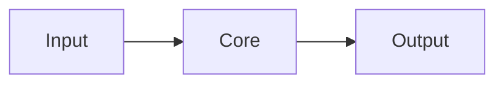

# project-name

> One sentence: what this does and for whom.


## Problem

What hurts today, in two or three sentences. Concrete, with numbers if possible.

## Solution

What this project does about it. One short paragraph.

## Architecture



## Quickstart

```bash
# one command to get it running
```

## Results

| Metric | Value |
| --- | --- |
| e.g. accuracy, latency, cost per run | — |

## Technical decisions

Key decisions live in [`docs/adr/`](docs/adr/). The most important ones:

- [ADR 0001](docs/adr/0001-record-architecture-decisions.md): we record decisions as ADRs.

## Roadmap

- [ ] Next milestone

## License

[MIT](LICENSE)
